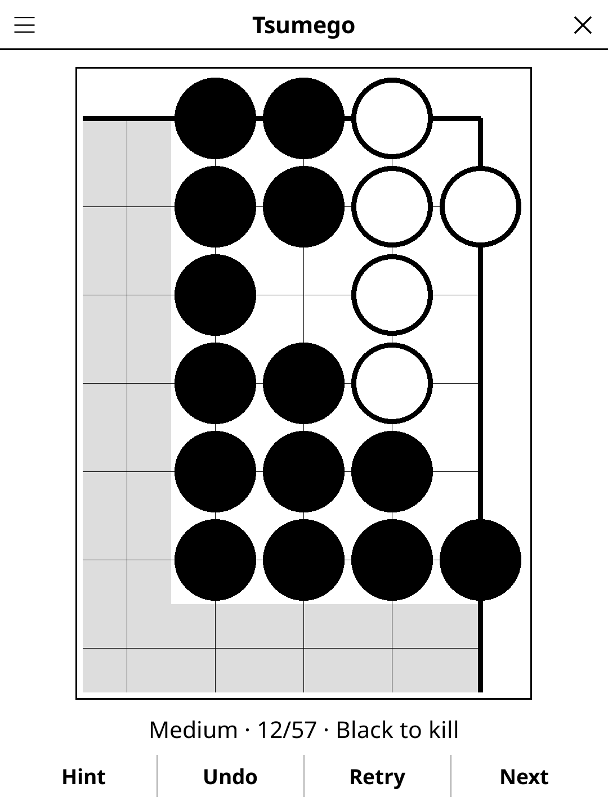

# tsumego.koplugin

Go life-and-death problems (tsumego) for [KOReader](https://github.com/koreader/koreader).

## Screenshot



## Rules

Each problem shows a corner of a 19×19 board. Black always plays.

- **Black to kill** — the White group must die: find the move that leaves it
  unable to make two eyes.
- **Black to live** — the Black group must make two eyes, or be safe.

Tap an intersection to play. White answers at once with its most stubborn
reply. Keep going until the result is *settled*: White could not change it
even if it were allowed two moves in a row. A wrong move is answered with a
refutation and the attempt fails; undo it or retry.

The stones bordering the problem (the unshaded area) are alive and cannot be
captured; play only inside them. There is exactly one correct first move.

## Features

- **207 proven problems** in three levels by the length of the main
  line: Easy (one Black move, 113), Medium (two, 57), Hard (three
  or more, 37)
- **Progress** — solved count per level; a problem counts when solved without
  a hint or the solution
- **Hint** — two taps: the first marks a correct move with a square, the
  second plays it
- **Show solution** — the main line numbered on the board, book style
- **Undo / Retry / Next problem**, timer, auto-save of the problem in progress
- Eight orientations: problems appear in every corner

## Where the problems come from

None is typed in by hand. A wrong tsumego is worse than none, so every
problem is **generated and proven by an exhaustive life-and-death search**
(`solver.lua`), offline, and re-proven by the test suite on every run.

The model is the classic enclosed problem: a small corner region (5 to 14
empty points) bounded by a wall of the attacker's stones, which are alive and
cannot be captured. Either side may pass.

- **Alive** means *unconditionally* alive by Benson's algorithm: a block that
  survives even if its owner never moves again (two real eyes).
- **Dead** is decided by a sound static rule (no room is left for two eyes)
  or by searching to the end.
- **Ko and seki** are handled conservatively. Every position is solved twice:
  once with every ko and every seki going to the attacker, once with every ko
  and every seki going to the defender. A claim is kept only if it holds in
  the case least favourable to it. A move whose result depends on a ko or a
  seki is "unclear", and a problem containing one anywhere in its tree is
  thrown away.

A position becomes a problem only if exactly one first move succeeds and
every other move — passing included — fails, both however ko and seki are
resolved. Its solution tree stores, at every Black turn, each correct move
with White's most stubborn answer and each wrong move with a refutation, all
proven the same way. White's answers on the device are read from that tree:
there is no search on the e-reader.

To regenerate the bank (LuaJIT, a few cores, tens of minutes):

```sh
luajit gen/gen_bank.lua 10000 6000 part1.lua           # seeds 10000..15999
luajit gen/gen_bank.lua 50000 6000 part2.lua 30000 3 big  # hunt longer problems
luajit gen/merge_bank.lua problems.lua part1.lua part2.lua
luajit test_verify.lua                                 # re-prove everything
```

## Controls

| Action | How |
|--------|-----|
| Play a stone | Tap an intersection inside the problem |
| Hint | Tap **Hint** (twice to play the hinted move) |
| Take back a move | Tap **Undo** |
| Start the problem over | Tap **Retry** |
| Next problem | Tap **Next** |
| Level, solution, progress, rules | Title-bar menu |

## Installation

1. Download `tsumego.koplugin.zip` from the [latest release](../../releases/latest).
2. Extract into the `plugins/` folder of your KOReader data directory.
3. Restart KOReader.
4. Open the menu → **Tools** → **Tsumego**.

## Known limitations

- Corner problems only; no side or open-board problems.
- The problems are machine-made: compact and correct, but without the themes
  and names of a classical collection, and some shapes look artificial.
- Levels count Black moves in the main line, a rough measure of difficulty.
- Proofs are exact under rules without superko (Japanese style). Under a
  superko rule, a strategy found through the search's transposition table
  could in principle cross a position from another branch; the search treats
  every repetition it meets in the case least favourable to the claim.
- The solution tree covers every Black move, but you cannot pass.

## License

GPL-3.0 — see [LICENSE](LICENSE).
